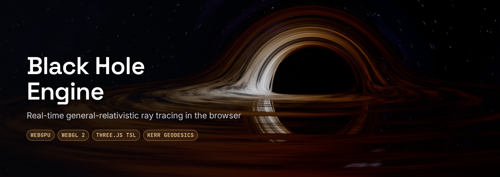
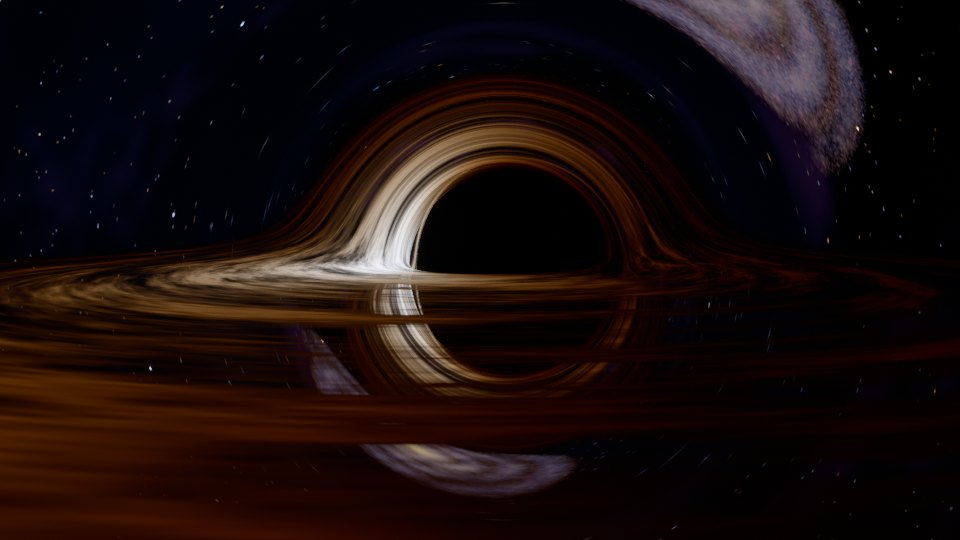
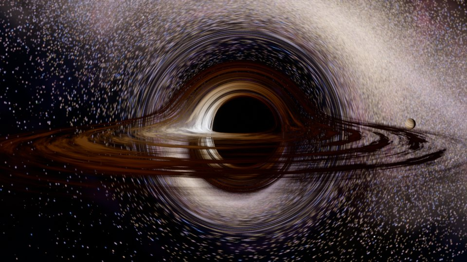
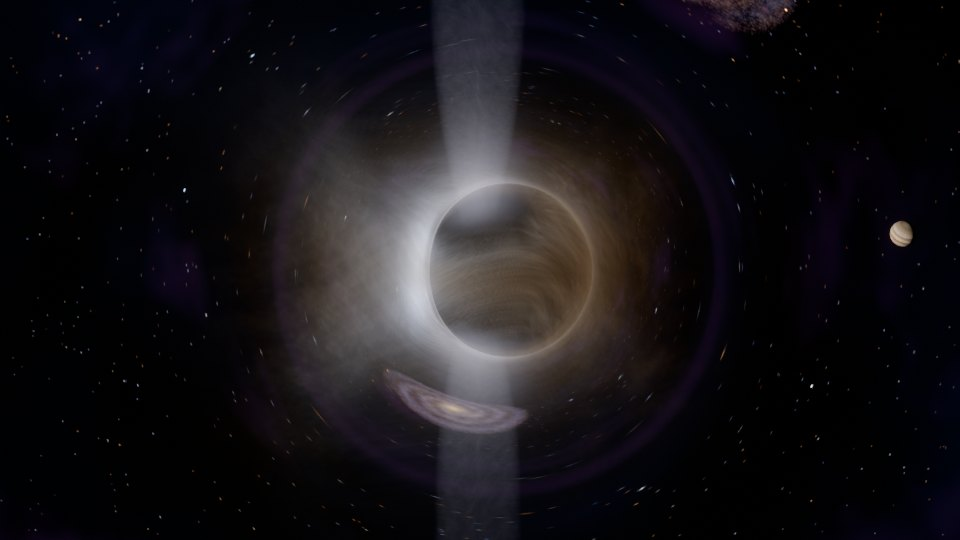
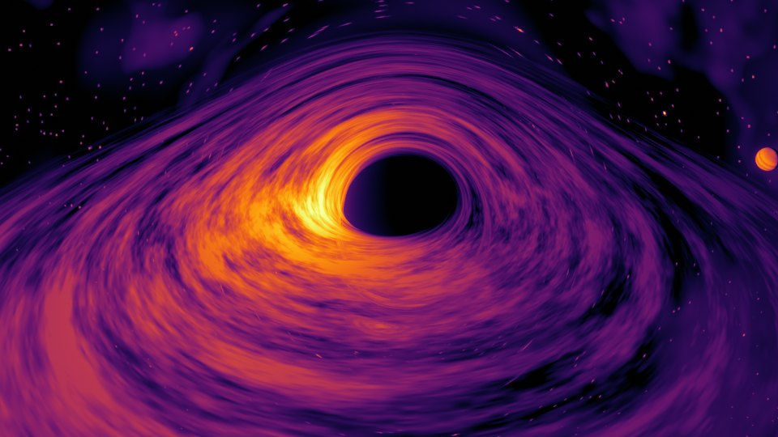
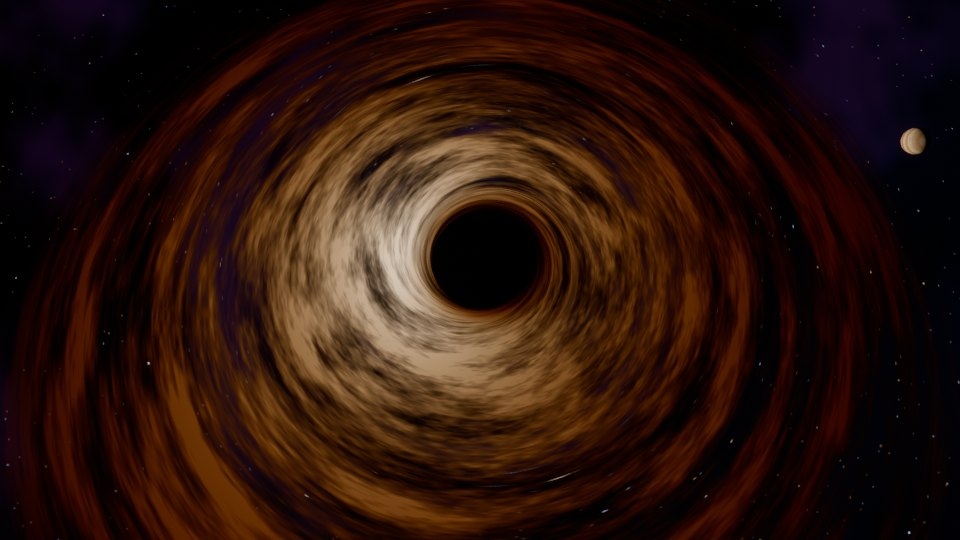
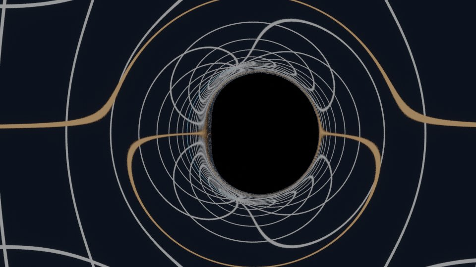
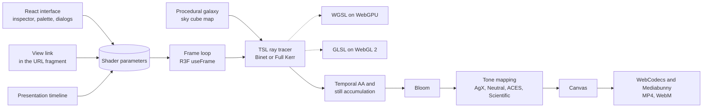

<div align="center">

<a href="https://e-choness.github.io/black-hole-engine/"></a>

<br>

[](https://github.com/e-choness/black-hole-engine/actions/workflows/ci.yml)
[](https://e-choness.github.io/black-hole-engine/)
[](https://github.com/e-choness/black-hole-engine/commits/main)
[](https://github.com/e-choness/black-hole-engine/graphs/commit-activity)
[](LICENSE)

[](https://threejs.org)
[](https://react.dev)
[](https://r3f.docs.pmnd.rs)
[](https://vite.dev)
[](package.json)
[](#browser-support)
[](#quick-start)
[](https://www.conventionalcommits.org/)

**[Live demo](https://e-choness.github.io/black-hole-engine/)** ·
[Features](#features) ·
[Gallery](#gallery) ·
[Quick start](#quick-start) ·
[Controls](#controls) ·
[How it works](#how-it-works) ·
[Architecture](#architecture) ·
[Contributing](#contributing)

</div>

**Black Hole Engine** is a real-time black hole renderer that runs in the browser. Every pixel traces a light ray through
curved spacetime on the GPU, with WebGPU on desktop and WebGL 2 on phones and tablets, so the
lensed sky, the accretion flow and relativistic jets are recomputed live as you move the camera or
change the physics. A timeline editor turns any setup into a scripted presentation that can be
recorded to video.

## Features

### Physics

- **Gravitational lensing** with three solvers: the exact Schwarzschild photon-orbit (Binet)
  equation, the same light paths with Kerr disk velocities, and full Kerr geodesics, which
  reproduce the flattened, shifted shadow of a spinning black hole.
- **Accretion flows**: a Novikov-Thorne thin disk with Kerr redshift, thick ADAF/RIAF torus,
  super-Eddington slim disk and GRMHD-inspired variants, with Doppler beaming, gravitational
  redshift and blackbody colours; the thin disk shows turbulent arcs sheared by its rotation.
- **Jets, a planet and a galaxy**: relativistic jets, an orbiting Jupiter (from a Cassini colour
  map) lit by the disk, and a lensed, rotating procedural galaxy, star field and nebula that can
  be seen from outside, from its centre or from within its disk.
- **Physical scale**: masses from stellar black holes to quasars, with presets such as Sgr A\*,
  M87\*, Cygnus X-1 and TON 618, derived quantities in physical units, and clocks that compare
  your proper time with a distant observer's.
- **Observers**: circular orbits plus scripted "dive" and "hover" scenarios, including a dive
  through the horizon.

### Rendering

- One set of shaders written in three.js TSL, compiled to WGSL for WebGPU and to GLSL for
  WebGL 2.
- AgX, Khronos PBR Neutral, ACES and false-colour scientific tone mapping, energy-conserving
  bloom, temporal anti-aliasing and the accumulation of still views.
- Quality presets from Mobile to Cinematic; a one-time GPU benchmark picks the default.

### Interface

- A searchable parameter inspector, a command palette (<kbd>Ctrl</kbd>/<kbd>Cmd</kbd>+<kbd>K</kbd>),
  keyboard shortcuts (<kbd>?</kbd>), physics notes, sound that follows the simulation and a layout
  for phones.
- Links that restore the whole view, and an installable app that works offline.

### Presentation and capture

- A presentation timeline with keyframed parameters, camera motion, annotations, bundled tours
  and JSON import/export.
- PNG screenshots, frame-exact offline rendering to MP4 (H.264) or WebM (VP9 or AV1) through
  WebCodecs and [Mediabunny](https://mediabunny.dev), and real-time recording through
  MediaRecorder. Where the File System Access API is available, offline renders stream straight
  into the chosen file instead of being held in memory.

## Gallery

Every image is a view link: click one to open that exact view in the live demo.

<!-- gallery:start (scripts/render-readme-media.js) -->

<table>
  <tr>
    <td width="50%" valign="top">
      <a href="https://e-choness.github.io/black-hole-engine/#v=4&amp;ca=0,-4,0&amp;od=11"></a>
      <br><sub>Novikov–Thorne thin disk with turbulent arcs, a/M = 0.9 · <a href="https://e-choness.github.io/black-hole-engine/#v=4&amp;ca=0,-4,0&amp;od=11">open live</a></sub>
    </td>
    <td width="50%" valign="top">
      <a href="https://e-choness.github.io/black-hole-engine/#v=4&amp;ca=0,-6,0&amp;od=16&amp;kv=disk&amp;kd=0.62&amp;ki=88&amp;kp=25&amp;ko=75&amp;ka=5"></a>
      <br><sub>Inside the disk of the lensed procedural galaxy · <a href="https://e-choness.github.io/black-hole-engine/#v=4&amp;ca=0,-6,0&amp;od=16&amp;kv=disk&amp;kd=0.62&amp;ki=88&amp;kp=25&amp;ko=75&amp;ka=5">open live</a></sub>
    </td>
  </tr>
  <tr>
    <td width="50%" valign="top">
      <a href="https://e-choness.github.io/black-hole-engine/#v=4&amp;ca=0,-14,0&amp;od=14&amp;dm=torus&amp;je=1&amp;jm=phys"></a>
      <br><sub>Thick ADAF torus with relativistic jets · <a href="https://e-choness.github.io/black-hole-engine/#v=4&amp;ca=0,-14,0&amp;od=14&amp;dm=torus&amp;je=1&amp;jm=phys">open live</a></sub>
    </td>
    <td width="50%" valign="top">
      <a href="https://e-choness.github.io/black-hole-engine/#v=4&amp;ca=0,-28,0&amp;od=13&amp;lt=sci"></a>
      <br><sub>False-colour luminance with the Scientific tone mapper · <a href="https://e-choness.github.io/black-hole-engine/#v=4&amp;ca=0,-28,0&amp;od=13&amp;lt=sci">open live</a></sub>
    </td>
  </tr>
  <tr>
    <td width="50%" valign="top">
      <a href="https://e-choness.github.io/black-hole-engine/#v=4&amp;ca=0,-62,0&amp;od=15"></a>
      <br><sub>The thin disk from high above · <a href="https://e-choness.github.io/black-hole-engine/#v=4&amp;ca=0,-62,0&amp;od=15">open live</a></sub>
    </td>
    <td width="50%" valign="top">
      <a href="https://e-choness.github.io/black-hole-engine/#v=4&amp;ca=0,-1,0&amp;od=10&amp;bs=0.998&amp;de=0&amp;ne=0&amp;km=grid"></a>
      <br><sub>Shadow of a near-extremal Kerr hole on a coordinate grid · <a href="https://e-choness.github.io/black-hole-engine/#v=4&amp;ca=0,-1,0&amp;od=10&amp;bs=0.998&amp;de=0&amp;ne=0&amp;km=grid">open live</a></sub>
    </td>
  </tr>
</table>

<!-- gallery:end -->

> [!TIP]
> The banner and the gallery are rendered by the simulation itself, and the script also rewrites
> the block above:
> `docker compose run --rm e2e node scripts/render-readme-media.js`

## Quick start

The only requirement is Docker with Compose v2. Nothing is installed on the host: every tool runs
in a container.

```sh
docker compose up dev
```

Then open <http://localhost:5173>. Source changes reload in the browser.

| Command                                                           | What it does                                                 |
| ----------------------------------------------------------------- | ------------------------------------------------------------ |
| `docker compose up dev`                                           | Vite dev server with hot module reload                       |
| `docker compose run --rm test`                                    | ESLint, Prettier check and Vitest unit tests                 |
| `docker compose run --rm build`                                   | Production build into `dist/`                                |
| `docker compose up --build preview`                               | Production nginx image on <http://localhost:8080>            |
| `docker compose run --rm e2e`                                     | Playwright e2e tests in headless Chromium on software WebGPU |
| `docker compose run --rm e2e npx playwright test --grep @smoke`   | Only the smoke e2e tests, as CI runs them on a push          |
| `docker compose run --rm -e VITE_BACKEND=webgl e2e`               | The e2e tests on the WebGL 2 backend                         |
| `docker compose run --rm e2e node scripts/render-readme-media.js` | Render the README banner and gallery                         |
| `docker compose run --rm test npm run format`                     | Format with Prettier and apply ESLint fixes                  |
| `docker compose run --rm test npm run check:deprecated`           | Fail if the lockfile installs a deprecated package version   |
| `docker compose run --rm test npm install <pkg>`                  | Add a dependency (updates `package.json` and the lockfile)   |
| `docker compose down --remove-orphans`                            | Stop and remove the project's containers                     |

<details>
<summary><b>Configuration</b>: ports, cache directory and file watching</summary>

<br>

Settings can be exported or put in a `.env` file next to `compose.yaml`:

| Variable           | Default    | Purpose                                                              |
| ------------------ | ---------- | -------------------------------------------------------------------- |
| `BH_DEV_PORT`      | `5173`     | Host port of the dev server                                          |
| `BH_PREVIEW_PORT`  | `8080`     | Host port of the preview server                                      |
| `BH_CACHE_DIR`     | `./.cache` | Directory that holds every cache                                     |
| `BH_WATCH_POLLING` | `1`        | Poll for file changes; Docker Desktop bind mounts drop change events |

The test, build and e2e services never publish ports, so they can run while the dev server is up.
The Compose project name comes from the directory, so separate checkouts (for example git
worktrees) get their own containers and volumes.

</details>

<details>
<summary><b>Caches and volumes</b></summary>

<br>

All caches live under `BH_CACHE_DIR` (`.cache/`, ignored by git) and are bind-mounted into the
containers:

| Path                 | Contents                                                                   |
| -------------------- | -------------------------------------------------------------------------- |
| `.cache/npm`         | npm download cache shared by all tooling containers                        |
| `.cache/screenshots` | Screenshots from the smoke e2e test (`smoke-page.png`, `smoke-render.png`) |
| `.cache/playwright`  | Playwright HTML report (`report/`) and failure traces (`test-results/`)    |

`node_modules` lives in named volumes scoped to the Compose project (`node_modules` for the Node
tooling, `node_modules_e2e` for the Playwright image), so the host never receives a Linux
dependency tree. The container entrypoint runs `npm ci` automatically whenever `package-lock.json`
changes, so dependency updates do not require an image rebuild.

Images, containers and volumes carry the label `com.black-hole.project=black-hole`:

```sh
docker compose down --volumes --remove-orphans
docker image prune --all --filter label=com.black-hole.project=black-hole
```

</details>

## Browser support

The simulation needs WebGPU or WebGL 2 and explains in the page when both are missing.

| Browser                                              | Backend | Shaders     |
| ---------------------------------------------------- | ------- | ----------- |
| Desktop browsers with WebGPU                         | WebGPU  | WGSL        |
| Phones, tablets, Firefox and browsers without WebGPU | WebGL 2 | GLSL ES 3.0 |

`?backend=webgl` or `?backend=webgpu` overrides the choice. Offline recording also needs
WebCodecs.

## Controls

| Action             | Mouse                                       | Touch       |
| ------------------ | ------------------------------------------- | ----------- |
| Orbit              | Drag                                        | One finger  |
| Pan                | Right-drag                                  | Two fingers |
| Roll               | Drag with both buttons                      |             |
| Zoom               | Scroll                                      | Pinch       |
| Command palette    | <kbd>Ctrl</kbd>/<kbd>Cmd</kbd>+<kbd>K</kbd> |             |
| Keyboard shortcuts | <kbd>?</kbd>                                |             |

## How it works

Rays are traced backwards from the camera until they fall into the hole, escape to the sky or run
out of steps, and every emitter they cross on the way adds light. The solver is chosen in the
inspector; each quality preset brings a default.

| Solver                        | Light paths                                                     | Default of                                         |
| ----------------------------- | --------------------------------------------------------------- | -------------------------------------------------- |
| Fast (Binet lensing)          | Schwarzschild Binet equation with heuristic spin lensing        | chosen by hand; exact for $`a = 0`$                |
| Kerr-inspired disk velocities | the same photons with Kerr ISCO and Keplerian disk velocities   | Mobile, Optimal, Medium; every preset at $`a = 0`$ |
| Full Kerr                     | null geodesics of the Kerr metric, adaptive Dormand-Prince 5(4) | High, Ultra, Cinematic                             |

In the plane of its orbit a Schwarzschild photon obeys the Binet equation for $`u = 1/r`$:

```math
\frac{d^2u}{d\varphi^2} + u = \frac{3}{2}\, r_s\, u^2
```

The Full Kerr solver integrates Hamilton's equations for $`H = \tfrac{1}{2} g^{\mu\nu} p_\mu p_\nu = 0`$
in Cartesian Kerr-Schild coordinates, which stay regular across the horizon, so the camera can
dive through it:

```math
g_{\mu\nu} = \eta_{\mu\nu} + f\, l_\mu l_\nu, \qquad f = \frac{2 M r^3}{r^4 + a^2 z^2}
```

Each emitter is shifted by the frequency ratio $`g = \nu_\text{obs} / \nu_\text{emit}`$ of its ray.
For gas on prograde circular orbits, with the conserved photon energy $`E`$ and angular momentum
$`L_z`$, both per unit of the frequency seen by the camera,

```math
g = \frac{1}{u^t \left(E - \Omega L_z\right)}, \qquad \Omega = \frac{\sqrt{M}}{r^{3/2} + a \sqrt{M}},
```

and the specific intensity scales as $`g^3`$, because $`I_\nu / \nu^3`$ is invariant along a ray.
The thin disk radiates as a blackbody at $`T(r) = T_\text{peak} \left(F(r) / F_\text{max}\right)^{1/4}`$,
with the Page-Thorne flux $`F(r)`$.

> [!NOTE]
> The shadow is checked against theory. At $`a = 0`$ its angular radius matches Synge's
> $`\sin\psi = \tfrac{3\sqrt{3}}{2} \tfrac{r_s}{r} \sqrt{1 - r_s/r}`$ within 1 % in both solvers,
> and at $`a/M = 0.9`$ the flattened edge matches the Bardeen critical curve within 3 % of its
> width. Unit tests cover the horizon, ISCO and photon-orbit radii, the conservation of $`H`$ and
> $`p_\varphi`$ along a geodesic, and the Page-Thorne flux. The full notes, with derivations,
> validation and performance, are in [`src/content/physics.md`](src/content/physics.md).

## Architecture



The renderer is three.js's `WebGPURenderer`, hosted in a React Three Fiber canvas; the engine stays
imperative inside the frame loop. The ray tracer is built from TSL nodes per variant of the
scene (solver family, flow model, jet mode), so each variant compiles only the code it uses.

<details>
<summary><b>Project structure</b></summary>

<br>

```text
index.html               page shell and Vite entry
src/app/main.js          application entry point
src/app/core/            renderer, render loop, runtime state, observer physics, scenarios
src/app/graphics/        bloom, output pass and the shared full-screen pass helpers
src/app/presentation/    timeline editor, presentation runtime and recording, bundled presets
src/app/scene/           camera runtime and the mouse and touch observer controls
src/app/sky/             procedural galaxy drawn into the sky cube map
src/app/ui/              engine actions for the interface, quality presets, colour-bar widget
src/ui/                  React interface: top bar, mode rail, inspector, time bar and dialogs
src/ui/viewport/         React Three Fiber canvas that creates the renderer and runs the frame loop
src/features/            galaxy model, units, clocks, sonification, view links and the offline app
src/content/             physics notes shown in the app
src/shaders/tsl/         ray tracer as three.js TSL nodes, built per variant of the scene
src/styles/              stylesheets of the page and the timeline editor
public/                  files served as-is: icons and the link-preview image
tests/unit/              Vitest unit tests
tests/e2e/               Playwright tests: rendering, controls, recording, GPU loss and support
config/                  build settings: security headers, PWA, link previews, legal notice
docker/                  container entrypoint and nginx configuration
scripts/                 build helpers and the README image renderer
.github/                 CI workflow, Dependabot configuration and the README images
```

</details>

## Deployment

**GitHub Pages.** On every push to `main`, CI lints, tests and builds the site, runs the e2e tests
tagged `@smoke` and deploys `dist/` to GitHub Pages (set the Pages source to "GitHub Actions").
Pull requests, a weekly run and manual runs take the whole e2e suite, split across four jobs.
Changes that touch only the README, its images or the Dependabot configuration start no run. A
separate job
asks the npm registry whether a locked package has been deprecated; it reports one without holding
back the deploy. Asset URLs are relative, so the site works under a project sub-path. Pages cannot
send custom headers, so the build embeds the Content Security Policy as a `<meta>` tag.

**Container.** The `runtime` stage of the Dockerfile serves the build with unprivileged nginx on
port 8080: content-hashed assets are cached for a year, `index.html` and the service worker are
always revalidated, responses are gzip-compressed and every response carries the security headers.
`/healthz` serves the container health check.

```sh
docker build --target runtime --tag black-hole:local .
docker run --rm -p 8080:8080 --read-only --tmpfs /tmp --cap-drop ALL black-hole:local
```

The security headers, including a CSP that allows WebGPU, WebGL 2, WebCodecs, Web Audio worklets
and service workers, are defined once in `config/security-headers.js` and applied to the Vite
preview server, the build-time `<meta>` tag and the nginx configuration.

## Test hooks

Two URL parameters make the app scriptable:

- `?quality=<preset>` starts with a quality preset (`mobile`, `optimal`, `medium`, `high`, `ultra`
  or `cinematic`) and skips the GPU benchmark. Unknown values are ignored.
- `?e2e=1` makes rendering deterministic: it skips the benchmark, ignores a preset stored by an
  earlier visit and freezes the simulation clock, so every frame shows the same scene.

<details>
<summary><b><code>window.__BH__</code></b> and the presentation API</summary>

<br>

`window.__BH__` is always defined and read-only:

| Property            | Description                                                                     |
| ------------------- | ------------------------------------------------------------------------------- |
| `ready`             | Promise that resolves on the animation frame after the first rendered frame     |
| `frameCount`        | Number of frames rendered so far                                                |
| `params`            | Live shader parameters (`null` before initialisation)                           |
| `accumulatedFrames` | Frames in the running mean of a static view                                     |
| `viewport`          | `{ canvas, passes }`: drawing-buffer and scene-target size as `[width, height]` |
| `sky`               | Galaxy sky status: cube face size, particle counts, colour format, revision     |
| `contextLost`       | `true` from the loss of the GPU device or context until rendering resumes       |
| `probeSky`          | `probeSky(width, height)` resolves to the sky cube as equirectangular RGB       |
| `loseGpuDevice`     | `loseGpuDevice()` takes the WebGPU device away; `false` on WebGL 2              |

```js
await page.goto('/?quality=mobile&e2e=1');
await page.evaluate(() => window.__BH__.ready);
await page.waitForFunction(() => window.__BH__.frameCount >= 24);
```

The canvas has the id `bh-canvas`.

`window.blackHolePresentation` is the presentation API the e2e tests drive, for example
`loadPreset(name)`, `startRecording(options)` (a promise that resolves to `true` once recording
has started), `stopRecording()`, `state()` and `getPathValue(path)`.

</details>

## Contributing

- Use [Conventional Commits](https://www.conventionalcommits.org/) with one change per commit.
- Run `docker compose run --rm test` and `docker compose run --rm e2e` before opening a pull
  request; CI runs the same checks.
- The e2e tests fail on console errors and on any console message about a deprecation, from this
  project or a dependency.
- Keep code comments about the code itself.

> [!IMPORTANT]
> The Playwright image tag in the Dockerfile `e2e` stage must match the `@playwright/test`
> version in `package.json`. Dependabot proposes the two updates separately, so merge them
> together.

## License

Licensed under the [PolyForm Noncommercial License 1.0.0](LICENSE).
